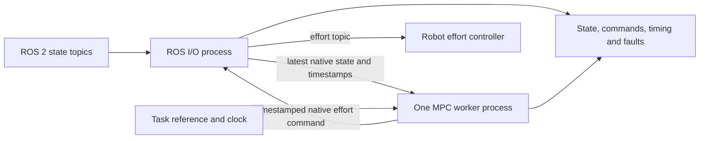

# ROS 2 with upstream MPCController

Use the existing upstream `gato.MPCController` unchanged for the first ROS 2
integration. Put ROS transport, command lifetime, task references and scheduling
in this repository. A copy of the old TIAGo solver/controller class is unnecessary.
This is a proposal for the control runner; the adapter port is implemented
separately in `tiago_mpc/ros2.py`. No hardware control run is qualified here.

The assessment is against the pinned GATO commit
`aeacf16e7733df1a17dfd6627f3b5d15c2ba4387`, rather than an uninspected newer release.

## Proposed ownership

The ROS process owns the adapter, executor, controller services and effort
publisher. It continues receiving state while the worker solves. Use bounded
latest-value state/command mailboxes, with sequence numbers, acquisition times,
task generation and expiry times; do not accumulate a queue of obsolete solves.
Only the worker accesses the solver and its `MPCController`. Initialize CUDA in
that spawned worker, rather than forking a process after CUDA initialization.

The port retains joint ordering, optional SEA absolute feedback, native joint
coordinates, command publishers, PAL interface validation and exclusive arm-mode
handover. The I/O runner still owns stale-state handling, command expiry,
controller restoration and the existing full-body collision/reset checks.
Closing the generic adapter only releases its ROS resources; it does not perform
a controller handback. The future runner must own that explicitly.

## What upstream already supplies

| Requirement | Existing API and responsibility |
|---|---|
| Construct once and reuse the solver | `gato.BSQP`, then `gato.MPCController(solver, ...)` |
| Start or deliberately restart a task | `reset(x0, xu_warm=...)`; copies the seed and resets duals |
| Optional initialization before enabling effort | `warmup(x, reference)`; no command is published by upstream |
| One control update from measured state | `step(x, reference, dt_elapsed=..., budget_s=...)` |
| Apply the selected control | `StepResult.u`; ROS publication belongs to this application |
| Inspect a selected full plan | `StepResult.xu_best`, with packed state/control stages |
| Configure limits and weights | Solver parameters, `limits_kw`, and public row-bound setters |
| Record behavior | Result timings, iterations, prediction error and row violations |

The controller deliberately performs no sleeping, simulation integration or I/O.
Its numpy inputs/outputs are suitable for the adapter. See
[controller.py](../external/gato/python/gato/controller.py), especially `reset`,
`warmup`, `step` and the final warm-start shift. The separate process is warranted
because [bindings.cu](../external/gato/python/bindings.cu) does not release the
Python GIL around the native solve. A Python executor thread in the same process
therefore cannot be assumed to keep running during that solve.

## First runner: measured feedback and one held effort

1. Load the reaching defaults from this repository, register/build the existing
   seven-joint model and complete model checks before enabling effort. Build and
   warmup time must not occur inside an active command interval.
2. Have the ROS process publish a fresh, complete native state snapshot. Retain
   separate body/arm freshness when using SEA feedback; unchanged joint values
   can still be a newly received measurement. Keep source timestamps and local
   monotonic receive times separately.
3. In the worker, map native state to the generated GPU model coordinates.
   For the currently supported seven-joint model this still reflects joint 6.
   Sample the reference horizon at the snapshot's task time, using the model's
   tool frame and torso-root frame; a world-frame target needs an explicit frame
   transform. Call `step` from that measured state.
4. Map `StepResult.u` back to native joint torques. Return it with the snapshot
   sequence, task generation, solve start/finish times and a command validity
   interval. The I/O process rejects expired or superseded results and publishes
   accepted effort in configured joint order. Hold the accepted effort until
   the next accepted update or expiry. Do not silently clip the torque or make
   the physical clock wait for the solve.
5. Pace from monotonic deadlines, skip missed scheduling slots and permit only
   one solve at a time. Record actual command application intervals and state age.
   Use ROS/simulation stamps for the task clock when appropriate; never subtract
   a ROS timestamp from a monotonic timestamp. Reset on simulation clock resets
   or task replacement rather than continuing the previous reference phase.

This first runner uses the first returned effort, not delayed playback of the
whole plan. Trajectory playback or prediction through communication delay can
be added later, with an explicit plan epoch and replay semantics. Neither is
provided automatically by `MPCController`.

The new reaching defaults are the ADMM-only N32/10 ms configuration that achieved
84/100 arrivals and 100/100 sampled physical-limit passes in internal simulation.
Use the committed default configuration as the source of parameters. That study
used an unpaid simulation clock, no passive joint losses, unconstrained
orientation and no collision checks. It does not establish a 100 Hz physical
controller. Its descriptive GTX1070 call latency was median 4.55 ms and p95
34.32 ms. ROS pacing must be evaluated separately before selecting a physical
update period.

## Where upstream is less flexible

**Elapsed time does not resample the warm start.** `dt_elapsed` is used only for
hypothesis scoring. The default `warm_start="shift"` advances exactly one knot
on each call, irrespective of missed periods or solve latency. Measured state
still replaces the first knot, so ordinary feedback is possible, but timing
equivalence with the old runner is not automatic. The first runner should target
one update per knot and log deviations. Passing a larger `dt_elapsed` does not
repair the warm-start time axis.

For substantial irregular timing, a small upstream extension would be useful:
a public elapsed-time warm-start shift, or a seed-transform hook with documented
dual/contact handling. The current public `reset(..., xu_warm=...)` can supply
an externally shifted seed, but also resets duals and controller history; it is
not an equivalent per-tick replacement. Do not access `_XU` from the ROS runner.

Felix requested a measurement before deciding whether that extension is worth
making. The separate `experiment/elapsed-warm-start` worktree compares the
existing shift against experimental elapsed-time resampling under identical
nominal and jittered application schedules. Judge tracking, physical limits and
solver work at sensible update frequencies. A source-level timing mismatch
alone is insufficient reason to change upstream. The experimental harness may
access private warm-start state to isolate this comparison; the proposed ROS
runner must not depend on that experiment-only access.

**A solve budget is advisory.** `budget_s` can stop at SQP iteration boundaries,
but at least one iteration runs. It cannot cancel a long GPU iteration or bound
ROS delivery/receiver latency. Expiry enforcement remains outside the optimizer.
The host runner also cannot enforce a timeout after it crashes: establish the
installed effort receiver's command-age behavior before physical deployment.

**Limits remain approximate.** The ADMM-only tests passed sampled executed raw
limits while some returned plans exceeded conservative planning bounds. Keep
the planning margins and independent execution checks. Do not turn an ADMM
return or zero-PCG shortcut into a physical-feasibility certificate or add a KKT
acceptance gate.

**Model features are a separate boundary.** ROS integration does not add native
full-robot MPC, passive friction modeling or orientation cost support. The
current demonstrated GATO application remains the seven-joint right arm.

## Reviewable next implementation

Implement a small process-based runner using the ownership above, reusing this
adapter and the existing `MPCController`. First exercise it with recorded ROS
state/command timing or internal simulation with paid solve time, then a ROS
simulator. Relevant checks are joint/sign mapping, fresh-state handling,
reference phase, stale result rejection and controller handback. Keep physical
execution as a separate manually reviewed script with explicit motion
confirmation and the existing reset/collision checks.

No upstream changes are necessary for this first runner. Consider an elapsed-time
warm-start hook only if the paired timing experiment shows a useful effect.
GIL release would be useful for a threaded
alternative, but is unnecessary for the proposed process separation.
