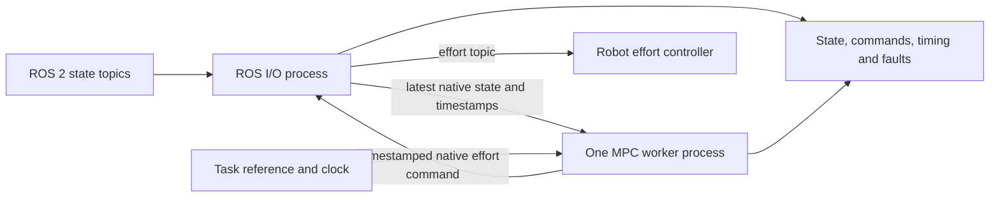

# ROS 2 with upstream MPCController

Use the existing upstream `gato.MPCController` unchanged for the first ROS 2
integration. Put ROS transport, command lifetime, task references and scheduling
in this repository. A copy of the old TIAGo solver/controller class is unnecessary.
The control runner is now implemented in `examples/ros2_mpc.py`, with a separate
MPC worker and the ported safety worker. See [usage and verification](ROS2_RUNNER.md).
The adapter is in `tiago_mpc/ros2.py`. No hardware control run is qualified here.

The original assessment and elapsed-shift study used GATO commit
`aeacf16e7733df1a17dfd6627f3b5d15c2ba4387`. The integration now uses main's
GATO 0.1.2 plus smooth-friction patch (`37a6768`), GRiD 0.5.3, current task
configurations and nominal grasp frame. Historical results below keep their
original scope; current validation is in [the runner guide](ROS2_RUNNER.md).

## Proposed ownership

The ROS process owns the adapter, executor, controller services and effort
publisher. It continues receiving state while the worker solves. Use bounded
latest-value state/command mailboxes, with sequence numbers, acquisition times,
task generation and expiry times; do not accumulate a queue of obsolete solves.
Only the worker accesses the solver and its `MPCController`. Initialize CUDA in
that spawned worker, rather than forking a process after CUDA initialization.

The port retains joint ordering, optional SEA absolute feedback, native joint
coordinates, command publishers, PAL interface validation and exclusive arm-mode
handover. The I/O runner still owns stale-state handling, command expiry,
controller restoration and the existing full-body collision/reset checks.
Closing the generic adapter only releases its ROS resources; it does not perform
a controller handback. The implemented runner owns that explicitly.

## What upstream already supplies

| Requirement | Existing API and responsibility |
|---|---|
| Construct once and reuse the solver | `gato.BSQP`, then `gato.MPCController(solver, ...)` |
| Start or deliberately restart a task | `reset(x0, xu_warm=...)`; copies the seed and resets duals |
| Optional initialization before enabling effort | `warmup(x, reference)`; no command is published by upstream |
| One control update from measured state | `step(x, reference, dt_elapsed=..., budget_s=...)` |
| Apply the selected control | `StepResult.u`; ROS publication belongs to this application |
| Inspect a selected full plan | `StepResult.xu_best`, with packed state/control stages |
| Configure limits and weights | Solver parameters, `limits_kw`, and public row-bound setters |
| Record behavior | Result timings, iterations, prediction error and row violations |

The controller deliberately performs no sleeping, simulation integration or I/O.
Its numpy inputs/outputs are suitable for the adapter. See
[controller.py](../external/gato/python/gato/controller.py), especially `reset`,
`warmup`, `step` and the final warm-start shift. The separate process is warranted
because [bindings.cu](../external/gato/python/bindings.cu) does not release the
Python GIL around the native solve. A Python executor thread in the same process
therefore cannot be assumed to keep running during that solve.

## First runner: measured feedback and one held effort

1. Load the reaching defaults from this repository, register/build the existing
   seven-joint model and complete model checks before enabling effort. Build and
   warmup time must not occur inside an active command interval.
2. Have the ROS process publish a fresh, complete native state snapshot. Retain
   separate body/arm freshness when using SEA feedback; unchanged joint values
   can still be a newly received measurement. Keep source timestamps and local
   monotonic receive times separately.
3. In the worker, map native state to the generated GPU model coordinates.
   For the currently supported seven-joint model this still reflects joint 6.
   Sample the reference horizon at the snapshot's task time, using the model's
   tool frame and torso-root frame; a world-frame target needs an explicit frame
   transform. Call `step` from that measured state.
4. Map `StepResult.u` back to native joint torques. Return it with the snapshot
   sequence, task generation, solve start/finish times and a command validity
   interval. The I/O process rejects expired or superseded results and publishes
   accepted effort in configured joint order. Hold the accepted effort until
   the next accepted update or expiry. Do not silently clip the torque or make
   the physical clock wait for the solve.
5. Pace from monotonic deadlines, skip missed scheduling slots and permit only
   one solve at a time. Record actual command application intervals and state age.
   Use ROS/simulation stamps for the task clock when appropriate; never subtract
   a ROS timestamp from a monotonic timestamp. Reset on simulation clock resets
   or task replacement rather than continuing the previous reference phase.

This proposal assumed the first returned effort; the runner now samples the
whole plan by knot (`docs/ROS2_RUNNER.md`). Prediction through communication
delay can be added later, with an explicit plan epoch. It is not provided
automatically by `MPCController`.

The historical ADMM-only N32/10 ms reaching configuration achieved
84/100 arrivals and 100/100 sampled physical-limit passes in internal simulation.
Its terminal weight was 800 and its target point was the flange; current
reaching uses 4/8 position weights and the grasp center. Use the committed
default configuration as the source of parameters. That historical study
used an unpaid simulation clock, no passive joint losses, unconstrained
orientation and no collision checks. It does not establish a 100 Hz physical
controller. Its descriptive GTX1070 call latency was median 4.55 ms and p95
34.32 ms. ROS pacing must be evaluated separately before selecting a physical
update period.

## Where upstream is less flexible

**Elapsed time does not resample the warm start.** `dt_elapsed` is used only for
hypothesis scoring. The default `warm_start="shift"` advances exactly one knot
on each call, irrespective of missed periods or solve latency. Measured state
still replaces the first knot, so ordinary feedback is possible, but timing
equivalence with the old runner is not automatic. The first runner should target
one update per knot and log deviations. Passing a larger `dt_elapsed` does not
repair the warm-start time axis.

For substantial irregular timing, a small upstream extension would be useful:
a public elapsed-time warm-start shift, or a seed-transform hook with documented
dual/contact handling. The current public `reset(..., xu_warm=...)` can supply
an externally shifted seed, but also resets duals and controller history; it is
not an equivalent per-tick replacement. Do not access `_XU` from the ROS runner.

Felix requested a measurement before deciding whether that extension is worth
making. The separate `experiment/elapsed-warm-start` worktree completed eight
24 s figure-eight episodes, comparing the existing shift against experimental
elapsed-time resampling with identical application schedules in each pair:

| Knot/update cadence | Schedule | Current shift RMS, mm | Elapsed shift RMS, mm |
|---|---|---:|---:|
| 10 ms / 100 Hz | Nominal | 6.628 | 6.628 |
| 10 ms / 100 Hz | Jitter/overruns | 6.686 | 6.691 |
| 30 ms / 33.3 Hz | Nominal | 9.468 | 9.468 |
| 30 ms / 33.3 Hz | Jitter/overruns | 9.494 | 9.492 |

Nominal pairs have identical saved states, plans and torques. Jittered schedules
use a deterministic pattern with 80% nominal intervals, 10% at 1.5 times nominal,
and 10% at the greater of nominal and 34 ms. This is a synthetic sensitivity
study informed by the retained reaching latency, not measured ROS timing.
The physical simulation advances throughout each interval under the applied
torque, and the reference follows accumulated simulated time. Actual solve wall
time is recorded separately and does not alter the paired schedule.

All eight episodes passed sampled raw joint limits. Jittered tracking differences
were below 0.005 mm RMS. SQP work was unchanged; elapsed resampling did not offer
a useful PCG/ADMM work reduction. Torques and plans do differ under jitter, so
the experiment exercises the changed seed rather than merely calling an unused
argument. These cases provide no practical reason to change upstream now.

The experimental harness accesses private primal warm-start state to isolate
resampling while retaining duals and controller history. It is not a supported
integration API, and the ROS runner must not depend on it. Evidence and the
full protocol were retained in the elapsed-shift worktree, subsequently removed
with its results at Felix's request. The table above is a historical summary.
This bounded no-loss tracking study does not settle faster or more disturbed
tasks, large timing gaps, or hypothesis-batch behavior.

**A solve budget is advisory.** `budget_s` can stop at SQP iteration boundaries,
but at least one iteration runs. It cannot cancel a long GPU iteration or bound
ROS delivery/receiver latency. Expiry enforcement remains outside the optimizer.
The host runner also cannot enforce a timeout after it crashes: establish the
installed effort receiver's command-age behavior before physical deployment.

**Limits remain approximate.** The ADMM-only tests passed sampled executed raw
limits while some returned plans exceeded conservative planning bounds. Keep
the planning margins and independent execution checks. Do not turn an ADMM
return or zero-PCG shortcut into a physical-feasibility certificate or add a KKT
acceptance gate.

**Model features are a separate boundary.** ROS integration does not add native
full-robot MPC or orientation cost support. The application remains the
seven-joint right arm. Current tracking explicitly selects the existing
smooth-friction/damping predictor; reaching retains its own loss-free default.

## Reviewable next implementation

The small process-based runner is implemented using this ownership, reusing the
adapter and existing `MPCController`. CPU fault/process-boundary tests and a
three-request real spawned GPU/native-simulation smoke pass. End-to-end ROS
simulation, paid-time task validation and physical deployment remain pending.
The entry point checks state/safety by default; execution requires explicit
motion confirmation, the complete safety gate and existing reset/path checks.

No upstream changes are necessary for this first runner. Keep the current shift
for these tested frequencies; revisit an elapsed-time hook if a new workload
shows a useful effect.
GIL release would be useful for a threaded
alternative, but is unnecessary for the proposed process separation.
