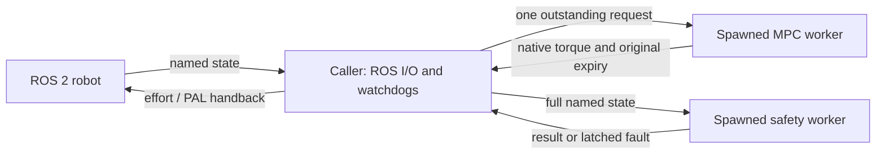

# ROS 2 MPC runner

`examples/ros2_mpc.py` implements the separate I/O, MPC and safety processes.
Upstream `gato.MPCController` and solver sources remain unchanged. The code is
integrated on `main`. ROS 2 is optional: simulation examples and package imports
do not require ROS packages or initialize ROS. Source a compatible ROS/PAL
environment only when constructing a ROS client.

The worker and simulation examples call the same package helpers in
`configuration.py`, `model_runtime.py`, `joint_dynamics.py` and `controller.py`.
The worker no longer dynamically imports example scripts. Only the simulation
loops use the fixed/measured latency model described in the README; ROS keeps
its measured feedback, monotonic leases and independent safety process.

## Review fixes and accepted limitations

The 21 October review led to three fixes: effort-controller setup and activation
validate the exact ordered joints and effort interface through its public
parameters; outstanding collision deadlines are enforced before accepting a
reply; and SEA body updates receive their own safety sequence without changing
arm feedback freshness. Focused regressions fail before these fixes and pass
afterwards.

Felix accepted two remaining limitations. Missing gripper mimic followers emit
a model-construction warning; they remain locked at neutral, so stationary finger
geometry can be wrong for a nonzero gripper pose. Task and worker configuration
still read the original file separately from the recorded copy; changing that
file during startup can produce inconsistent settings. Configuration snapshots
are unchanged.

Original reproductions remain in `_expr_data/ros2-code-review-20261021/`.
New CPU logs are in `/workspace/tiago_mpc-ros2-review-fixes/_expr_data/ros2-review-fixes/`.
Physical execution is not qualified.



The I/O owner keeps receiving while CUDA solves. One solve is outstanding at a
time; the next eligible update uses the latest state, skipping missed schedule
slots. CUDA/model construction occurs inside the spawned worker before effort
activation. Safety runs independently of the optimizer. Its reviewed geometry,
blacklist, joint limits, geometry-speed checks and timeouts are ported from the
old repository; see [actual coverage and provenance](SAFETY.md).

## Checks first

Initialize `external/gato`, install this checkout's dependencies and source the
compatible PAL ROS overlay and intended DDS network. See the [adapter guide](ROS2_ADAPTER.md).

```bash
git submodule update --init external/gato
python examples/ros2_mpc.py
python examples/ros2_mpc.py --sea-absolute
```

The default subscribes and checks fresh full named state through the real safety
worker. It creates no MPC worker, publishes no commands and performs no
controller-manager mutations. A fresh result directory is saved under
`_expr_data/ros2-runner/`. A failed check returns nonzero without changing the
margin or blacklist. Torso, both arms and head feedback are required.

The fixture with a comfortable right arm and every other body joint at zero
fails the preserved 4 cm clearance. That failure remains retained. Seven arm
angles do not qualify a complete physical posture.

## Explicit execution

```bash
python examples/ros2_mpc.py --execute --target X_M Y_M Z_M
```

Replace the placeholders with a reviewed reachable **grasp-center** target in
`torso_lift_link`, in metres. The tracked frame is `arm_right_grasp_joint`,
139.3 mm along the flange's local +Z at the nominal zero gripper posture.
Effective settings/units are printed; the operator must type
`EXECUTE` before the ROS client is constructed. This command has not been run
against a robot during implementation.

The runner uses committed `configs/reaching.json`: N32/10 ms, ADMM-only limits
and the selected planning margins. Execution requires PAL position mode and a
stationary arm within 0.05 rad per joint of comfortable_high_clearance:
`[-0.39, -1.73, -0.38, -2.35, 0, -1.21, 0.04]`.
No reset is commanded. Prior reset/full-path/scene verification and supervised
deployment remain required for physical use. Other torso/head/arm positions
must stay near their initial measured values. Observed wheel/gripper movement
is rejected; unobserved locked joints remain a limitation. Keep the mobile base
and grippers stationary.

`--task figure8 --config configs/tracking.json` uses the target as the reference
anchor, with the selected 2 cm +X edge clearance, 28 cm x span, 9 cm y amplitude
and 24 s period. Use `--duration 24` for a cycle. The selected configuration
provides 4/8 XYZ costs, ADMM-only limits and the smooth friction/damping
predictor (width .03 rad/s). Physical feedback is measured; no simulated plant
or passive torque is applied in the ROS I/O process. Reaching also selects the
smooth friction/damping predictor at .03 rad/s in `configs/reaching.json`.
No ROS tracking or new reaching-friction qualification is claimed.
Orientation remains unconstrained.
The I/O loop still uses its explicit 10 ms default, independently of the
tracking predictor's 2 ms knots; this does not promise a 2 ms ROS update rate.
References follow measured ROS timestamps and the existing one-knot warm-start
shift remains unchanged. The worker smoke below does not qualify this complete
ROS timing loop.

## Leases, safety and handback

Results carry source sequence/receipt time, task generation and their original
expiry. Receiving or republishing never renews a lease. Defaults are a 10 ms I/O
period and 100 ms state/command age limits, explicitly named in `RunnerConfig`.
Before every nonzero publication the runner checks native physical q/qd/u limits,
freshness, MPC liveness, safety and expiry. It rejects invalid results without
clipping torque. ROS source time controls reference phase; monotonic time
controls scheduling/leases. Reversed source time faults.

Initial full-body safety is checked after setup and again before activation.
The inactive receiver is primed with valid effort. During controller-manager
discovery, RPC waits and subscriber waits, bounded polling calls the same
state/safety/expiry guards. A running callback cannot be forcibly interrupted;
host supervision is not a hard real-time guarantee.

Completion, faults, Ctrl-C and SIGTERM trigger a bounded zero-effort burst and
explicit PAL position handback after an activation attempt. Preexisting effort
mode is rejected. Cleanup errors produce a fault. An interrupted activation RPC
leaves restoration **uncertain**, even if a later inventory shows position:
the dispatched action may still execute. The result requests manual controller
reconciliation; abandoning a future does not cancel the server action.

Installed receiver command-expiry/crash behavior still needs verification.
SIGKILL/host crashes cannot be handled by this watchdog. No live DDS/PAL/hardware
validation has been performed. Runtime monitoring supplements established
physical reset/path checks. `--budget-ms` is advisory, not a hard deadline.
The upstream one-knot shift is retained, following the elapsed-time experiment.

## Outputs and completed verification

Runs retain summary, JSONL events, selected config and source copies under
`_expr_data/`. Events include source/receipt times, full named feedback,
requests, native publications/expiries, solver work and safety sequence.
Unobserved nonfinite metadata is logged as JSON null; controlled feedback and
torque must still be finite. Runtime models/caches also stay in this checkout.

```bash
python -m pip install -r requirements-dev.txt
PYTHONPATH=external/gato/python PYTEST_DISABLE_PLUGIN_AUTOLOAD=1 \
  python -m pytest -q tests
```

After the review fixes (21 October 2026), **161 tests and 118 subtests pass**.
The subsequent setup consolidation passes **185 tests and 118 subtests**;
its spawned-worker smoke retains one first-reaching reply beyond the 100 ms
lease. See `VERIFICATION.md` for the baseline comparison and limits of this check.
The earlier main integration passed 147 tests and 118 subtests
using GATO 0.1.2 plus the existing smooth-friction patch, GRiD 0.5.3 and the new
grasp frame. ROS is not installed in the test environment. Package, I/O runner
and worker imports leave ROS, GATO and Pinocchio unloaded; importing the CLI's
collision settings requires the existing Pinocchio dependency, never ROS/CUDA.
Simulation and ROS CLI `--help` both work without ROS.

Two real spawned N32 GPU workers passed three requests each: current reaching
at 10 ms, and current tracking at 2 ms with smooth friction/damping and the
configured reference shape. The parent advanced an independent native Pinocchio
plant between replies (hard-sign/viscous losses for tracking). Both workers
reported the grasp frame and 4/8 weights, retained ADMM-only limits, returned
finite torques within raw effort bounds, preserved and met the original 100 ms
leases, and exited zero. This is a worker/transport/configuration smoke, not a
real ROS update-rate, full-task or hardware qualification. Collision-worker
faults, actual geometry and process/handback/expiry gates have separate CPU
coverage. No live ROS connection or robot commands were made.

Current raw logs, requests/replies, configurations and native histories:
`/workspace/tiago_mpc/_expr_data/ros2-worktree/ros2-main-integration/`, with GPU runs in
`gpu-20261021T152122Z/`. `scripts/prepare_models.py --check` and
`scripts/prepare_safety_model.py --check` pass; the active safety overlay retains
canonical actual-value metadata, unchanged reviewed geometry and blacklist.

Historical verification below retains its original scope. After the canonical
simulator-model correction, 142 tests and 118 subtests
passed on 20 October 2026. Coverage includes I/O/worker
doubles, real collision geometry, spawned safety-worker timeout/death, service
progress, failed handback, stale/expired/mismatched results, worker start/death,
slow logging across expiry, source-velocity arrival and already-met goals that
never activate effort. Healthy safety transport uses an explicit dummy checker;
it does not qualify a physical posture.

A real spawned GPU worker passed exactly three requests on GTX1070/N32/10 ms,
with native Pinocchio RK4 between updates. Model/sign/order checks passed;
native torques stayed finite/in raw bounds, original 100 ms leases were met,
and the worker exited zero. No ROS or hardware was involved. This is an
integration smoke, not task qualification or a timing benchmark. Its first plan
has a small retained planning-bound violation: ADMM remains approximate.
The arm already used the simulator kinematics/inertias; the correction changes
only its passive metadata. A fresh default reaching smoke at `d86e041` also
passed in 0.25 simulated seconds with zero sampled physical-limit excess.

CPU logs: `_expr_data/ros2-runner-20261020/checks/cpu-tests.log`.
Post-correction combined CPU log:
`_expr_data/canonical-model-correction-20261020/ros-integration-cpu.log`.
GPU inputs/replies/config/source/history/logs:
`_expr_data/ros2-runner-20261020/gpu-worker-smoke/20261020T215730.176115Z/`.

After removing the merged ROS2 worktree, these historical relative validation
paths resolve beneath main's `_expr_data/ros2-worktree/`. Original path strings
inside raw records remain unchanged.
